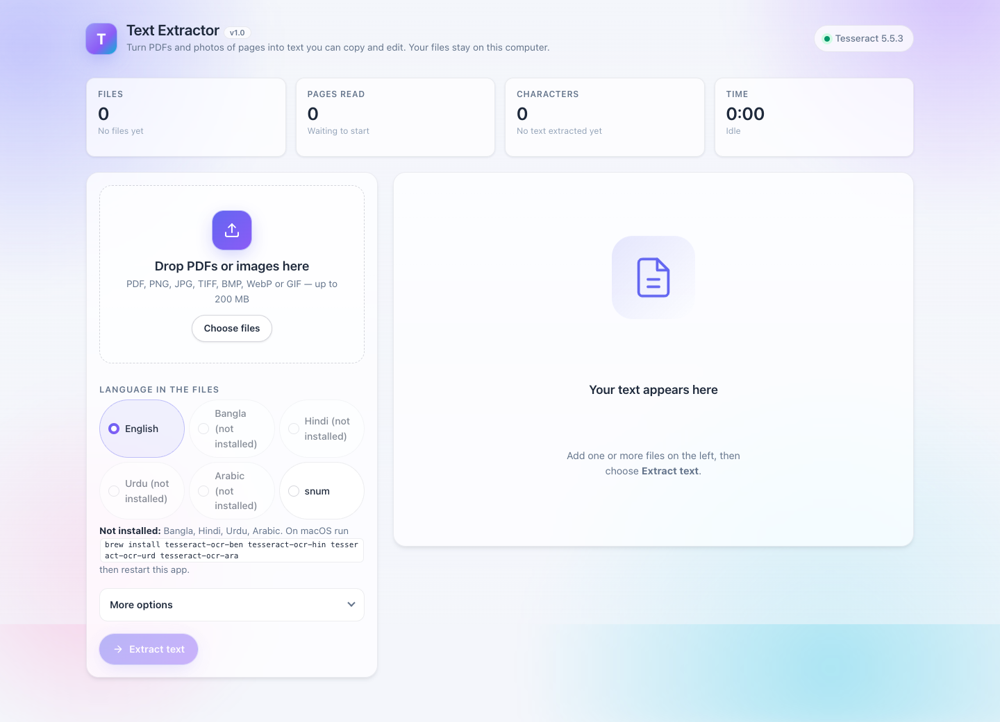
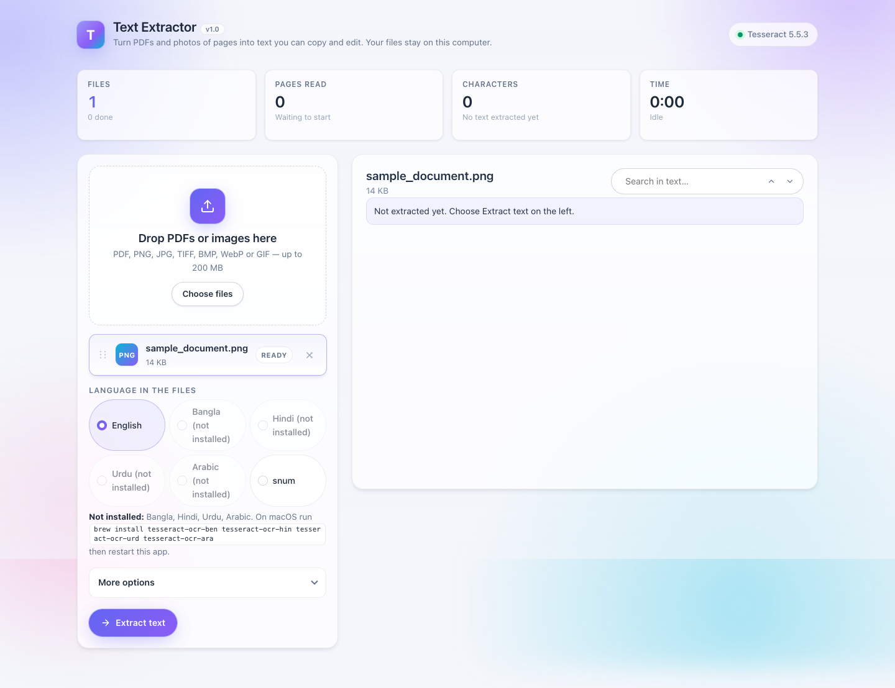
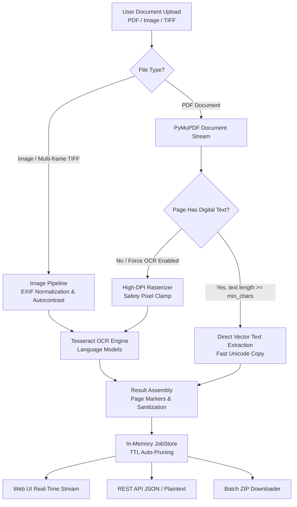

<div align="center">

# 📄 Text Extractor

### Privacy-First, Self-Hosted OCR & Digital PDF Text Extraction Engine

[](https://github.com/arafatsheikh098/Text-Extractor/actions/workflows/ci.yml)
[](https://github.com/arafatsheikh098/Text-Extractor/pkgs/container/text-extractor)
[](https://www.python.org/)
[](LICENSE)
[](https://github.com/astral-sh/ruff)
[](https://github.com/arafatsheikh098/Text-Extractor/actions)
[](https://github.com/arafatsheikh098/Text-Extractor/pkgs/container/text-extractor)
[]()

<p align="center">
  <b>Turn PDFs, scanned documents, and page photos into editable text — instantly, privately, and with zero cloud telemetry.</b>
</p>

[Key Features](#-key-features) •
[Architecture](#-architecture--how-it-works) •
[Quickstart](#-quick-start) •
[Cloud Deploy](#-1-click-cloud-deployment) •
[REST API](#-rest-api-documentation) •
[CLI Usage](#-command-line-interface-cli) •
[Configuration](#-configuration--environment-variables) •
[Production](#-production--reverse-proxy-guide)

</div>

---

## 🌟 Why Text Extractor?

Most OCR utilities either upload your sensitive documents to remote third-party servers, require complex databases, or lock you into cumbersome heavy desktop apps. **Text Extractor** is built differently:

- ⚡ **Dual-Engine Architecture**: Automatically detects born-digital PDFs to copy crystal-clear unicode text straight from the document stream in milliseconds (via PyMuPDF). If a page is scanned or rasterized, it seamlessly hands off only the raster pages to Tesseract OCR.
- 🛡️ **Air-Gapped Privacy & Security**: By default, the application only binds to `127.0.0.1` and actively enforces a strict **Host Guard** against DNS-rebinding attacks. No external tracking, no analytics, no persistent database.
- 🌍 **Out-of-the-Box Multi-Language OCR**: Bundled with language models for **English, Bengali (বাংলা), Hindi (हिन्दी), Urdu (اردو), Arabic (العربية), Assamese (অসমীয়া), Nepali (नेपाली), French, German, and Spanish**.
- 🖥️ **Clean Web UI + Headless REST API + CLI**: Access through an intuitive drag-and-drop web dashboard, call the JSON endpoints directly from your automation scripts, or run it headlessly in terminal pipelines.
- 📦 **Ephemeral In-Memory Lifecycle**: Jobs, temporary files, and extracted text are retained only for the configured TTL in memory and securely scrubbed upon completion or restart.

---

## 📸 Visual Tour & Web Dashboard

| Drag & Drop Web Interface | Live Extraction & Real-Time Stats |
| :---: | :---: |
|  |  |

---

## 🎯 Key Features

| Feature | Description |
| :--- | :--- |
| **Hybrid Document Parsing** | Direct unicode stream extraction for digital PDFs; automatic fallback to OCR for scanned pages or images. |
| **Comprehensive Format Support** | Accepts `.pdf`, `.png`, `.jpg`, `.jpeg`, `.tiff`, `.tif` (including multi-frame TIFF), `.bmp`, `.webp`, and `.gif`. |
| **Smart DPI Rasterization** | Adjustable rendering quality (150, 200, 300, 400 DPI) with automatic pixel limit guards to prevent decompression bombs. |
| **Batch Processing & Zip Export** | Upload up to 30 files at once; preview text in real-time and download all results in a single organized `.zip` file. |
| **Page Delimiters** | Optional `--- Page N ---` structural markers preserved in the extracted text. |
| **Force OCR Mode** | Toggle to bypass digital text layers and re-read corrupted or mis-encoded PDF fonts using OCR. |
| **Cancellation & Progress Stream** | Real-time page-by-page progress reporting with the ability to abort active processing jobs instantly. |
| **Non-Root Docker Execution** | Containerized under a dedicated unprivileged user (`app`, UID 1000) with built-in healthchecks. |

---

## 🏗️ Architecture & How It Works



---

## 🚀 Quick Start

### Option 1: Docker (Recommended)

The official Docker image comes pre-configured with Tesseract 5 and all 8 language models ready to go:

```bash
docker run --rm -p 127.0.0.1:8765:8765 ghcr.io/arafatsheikh098/text-extractor:latest
```

Open **[http://127.0.0.1:8765](http://127.0.0.1:8765)** in your browser.

#### Using Docker Compose:

```bash
# Clone the repository
git clone https://github.com/arafatsheikh098/Text-Extractor.git
cd Text-Extractor

# Start service
docker compose up -d
```

---

### Option 2: Local Python Installation

#### 1. System Requirements
You need **Python 3.10+** and the **Tesseract OCR** binary:

- **macOS** (via Homebrew):
  ```bash
  brew install tesseract tesseract-lang
  ```
- **Ubuntu / Debian**:
  ```bash
  sudo apt update
  sudo apt install -y tesseract-ocr tesseract-ocr-eng tesseract-ocr-ben tesseract-ocr-hin
  ```
- **Windows**:
  Download and install the official [UB Mannheim Tesseract installer](https://github.com/UB-Mannheim/tesseract/wiki). Check the language data boxes you need, and ensure `tesseract.exe` is added to your system `PATH`.

#### 2. Install and Run
```bash
git clone https://github.com/arafatsheikh098/Text-Extractor.git
cd Text-Extractor

# Create and activate virtual environment
python3 -m venv .venv
source .venv/bin/activate  # Windows: .venv\Scripts\activate

# Install package
pip install -e .

# Launch application (opens your default browser automatically)
text-extractor
```

---

## ☁️ Cloud Deployment (Render, Railway, Fly.io, or VPS)

Text Extractor is completely stateless and ready for any Docker-compatible cloud platform:

1. **Deploy with Docker**:
   - In your cloud dashboard (Render, Railway, Fly.io, DigitalOcean, or Coolify), choose **Deploy Dockerfile**.
   - Set the exposed container port to `8765`.
   - Configure environment variables:
     - `ALLOW_REMOTE=1` (allows external network traffic)
     - `TRUSTED_PROXIES=1` (enables reverse-proxy header trust)
2. **Configuration**:
   - Refer to [`.env.example`](.env.example) for all customizable options.

---

## 💻 Command-Line Interface (CLI)

Run `text-extractor --help` to inspect all options:

```
usage: text-extractor [-h] [--host HOST] [--port PORT] [--tessdata PATH]
                      [--no-browser] [--allow-remote] [--max-upload-mb MB]
                      [--max-files N] [--version]
```

### Options Reference

| Flag | Default | Description |
| :--- | :---: | :--- |
| `--host <ip>` | `127.0.0.1` | Network interface to bind to (`0.0.0.0` for all interfaces). |
| `--port <port>` | `8765` | Port number to listen on. |
| `--tessdata <dir>` | *auto* | Path to custom folder containing `*.traineddata` language files. |
| `--no-browser` | `False` | Disables automatic browser launch upon startup. |
| `--allow-remote` | `False` | Allows requests from non-localhost clients and bypasses Host Guard. |
| `--max-upload-mb <mb>`| `200` | Maximum combined upload payload in megabytes. |
| `--max-files <n>` | `30` | Maximum number of files processed in a single batch. |
| `--version` | — | Display the installed version of `text-extractor`. |

### CLI Example:
```bash
# Listen on custom port headlessly without opening browser
text-extractor --port 9000 --no-browser

# Expose on local network with custom language models folder
text-extractor --host 0.0.0.0 --port 8765 --allow-remote --tessdata /opt/tessdata
```

---

## 📡 REST API Documentation

The web UI consumes the same documented JSON REST API that you can use in Python, Node.js, Go, or shell scripts:

### 1. Capability & Language Discovery
```http
GET /api/info
```
**Response:**
```json
{
  "tesseract": true,
  "version": "5.3.0",
  "languages": [
    { "code": "eng", "name": "English" },
    { "code": "ben", "name": "Bangla" }
  ],
  "max_files": 30,
  "max_upload_mb": 200,
  "extensions": [".pdf", ".png", ".jpg", ".jpeg", ".tiff", ".bmp", ".webp", ".gif"]
}
```

---

### 2. Submit Extraction Job
```http
POST /api/jobs
Content-Type: multipart/form-data
```

**Parameters:**
- `files[]`: One or more files (`.pdf`, `.png`, etc.).
- `lang`: Tesseract language token (e.g., `eng`, `ben`, `eng+ben`).
- `dpi`: Rasterization quality (`150`, `200`, `300`, `400`). Default `300`.
- `force_ocr`: Set to `1` to force OCR on digital PDFs.
- `page_markers`: Set to `1` to prefix each page with `--- Page N ---`.

**cURL Example:**
```bash
curl -X POST http://127.0.0.1:8765/api/jobs \
  -F "files=@invoice.pdf" \
  -F "files=@receipt.jpg" \
  -F "lang=eng" \
  -F "dpi=300" \
  -F "page_markers=1"
```
**Response:** `201 Created`
```json
{ "job_id": "8fa1e48f6c4c414bb169123b72c91834" }
```

---

### 3. Check Job Status
```http
GET /api/jobs/{job_id}
```
**Response:**
```json
{
  "id": "8fa1e48f6c4c414bb169123b72c91834",
  "status": "done",
  "files": [
    {
      "id": "f0",
      "name": "invoice.pdf",
      "status": "done",
      "pages_total": 2,
      "pages_done": 2,
      "text_pages": 2,
      "ocr_pages": 0,
      "chars": 1845,
      "error": null,
      "warning": null
    }
  ]
}
```

---

### 4. Fetch Extracted Text
```http
GET /api/jobs/{job_id}/files/{file_id}/text
Accept: text/plain; charset=utf-8
```
**cURL Example:**
```bash
curl http://127.0.0.1:8765/api/jobs/8fa1e48f6c4c414bb169123b72c91834/files/f0/text > extracted.txt
```

---

### 5. Download Results as ZIP Archive
```http
POST /api/zip
Content-Type: application/json
```
```json
{
  "files": [
    { "name": "document1.pdf", "text": "Extracted text content here..." },
    { "name": "scan2.jpg", "text": "Another file text..." }
  ]
}
```
Returns: `application/zip` download (`extracted-text.zip`).

---

## ⚙️ Configuration & Environment Variables

Copy `.env.example` to `.env` to configure your instance:

| Variable | Default | Purpose |
| :--- | :---: | :--- |
| `HOST` | `127.0.0.1` | Address the server binds to. |
| `PORT` | `8765` | Port the server listens on. |
| `ALLOW_REMOTE` | `0` | Set `1` to accept non-localhost clients (disables Host Guard). |
| `TRUSTED_PROXIES` | `0` | Number of upstream reverse proxies (e.g. `1` behind Nginx/Render). Enables `ProxyFix`. |
| `MAX_UPLOAD_MB` | `200` | Maximum request upload payload size. |
| `MAX_FILES` | `30` | Maximum number of files in a single job submission. |
| `OCR_WORKERS` | `1` | Concurrency worker threads for OCR processing. |
| `OCR_TIMEOUT_SECONDS`| `180` | Max duration per page before triggering timeout error. |
| `JOB_TTL_SECONDS` | `7200` | Retention duration for finished jobs before in-memory eviction. |
| `MAX_JOBS_KEPT` | `20` | Cap on maximum finished jobs retained in memory. |
| `TESSDATA_DIR` | *system* | Custom directory for `*.traineddata` OCR model files. |

---

## 🔒 Security & Threat Model

1. **Host Guard (DNS-Rebinding Defense)**: By default, `restrict_host=True` rejects requests whose `Host` header does not match local loopback names (`127.0.0.1`, `localhost`, `[::1]`).
2. **Strict Origin & CSRF Checks**: All state-changing requests (`POST`) validate the client's `Origin` header against the expected host.
3. **Decompression Bomb Mitigation**: Protects against zip-bomb images and maliciously crafted image headers via Pillow max pixel thresholds (`MAX_RENDER_PIXELS = 120,000,000`).
4. **Sandboxed File Operations**: Uploaded files are written to isolated temporary directories (`tempfile.mkdtemp()`) and guaranteed to be deleted in `finally` blocks.
5. **Content Security Policy (CSP)**: The web UI is protected by a strict nonce-based CSP (`default-src 'none'`) preventing inline script injection.

---

## 🌐 Production & Reverse Proxy Guide

When exposing Text Extractor in production behind a reverse proxy like **Nginx**, **Caddy**, or **Traefik**, ensure:
1. `ALLOW_REMOTE=1` is set in your environment.
2. `TRUSTED_PROXIES=1` is configured so client IPs and headers pass through correctly.
3. Upstream HTTP authentication (e.g., HTTP Basic Auth or OAuth proxy) is enabled, as Text Extractor has no built-in user login.

### Nginx Example Configuration:

```nginx
server {
    listen 80;
    server_name ocr.yourdomain.com;

    # Limit file upload sizes to match application settings
    client_max_body_size 200M;

    location / {
        proxy_pass http://127.0.0.1:8765;
        proxy_set_header Host $host;
        proxy_set_header X-Real-IP $remote_addr;
        proxy_set_header X-Forwarded-For $proxy_add_x_forwarded_for;
        proxy_set_header X-Forwarded-Proto $scheme;
        
        # Increase read timeouts for intensive OCR jobs
        proxy_read_timeout 300s;
        proxy_send_timeout 300s;
    }
}
```

---

## 🧪 Testing & Code Quality

Text Extractor maintains a comprehensive automated test suite and adheres to strict formatting standards:

```bash
# Install test dependencies
pip install -e ".[dev]"

# Run unit and integration tests
pytest

# Run tests with coverage reporting
pytest -v --cov=text_extractor --cov-report=term-missing

# Lint and check style with Ruff
ruff check src tests
```

---

## 📂 Project Structure

```
Text-Extractor/
├── .github/
│   ├── workflows/
│   │   ├── ci.yml                 # Matrix testing (Python 3.10 - 3.13)
│   │   └── docker-publish.yml     # Automated GHCR container publishing
│   ├── ISSUE_TEMPLATE/            # Bug report & feature request templates
│   ├── dependabot.yml             # Automated dependency security tracking
│   └── PULL_REQUEST_TEMPLATE.md
├── src/
│   └── text_extractor/
│       ├── app.py                 # Flask factory & ProxyFix wiring
│       ├── cli.py                 # Argument parser & browser launcher
│       ├── config.py              # Settings dataclass & from_env loader
│       ├── errors.py              # User-friendly error exceptions
│       ├── jobs.py                # JobStore & background worker runner
│       ├── ocr.py                 # Tesseract probing & error mapper
│       ├── processing.py          # PyMuPDF digital extract & OCR fallback
│       ├── routes/                # Blueprint endpoints (jobs, info, pages)
│       ├── static/                # CSS styling & vanilla JavaScript client
│       ├── templates/             # index.html with strict CSP
│       └── wsgi.py                # Production Gunicorn entrypoint
├── tests/                         # Full Pytest test suite (40 tests, 89% coverage)
├── Dockerfile                     # Hardened Debian Bookworm container
├── docker-compose.yml             # Single-command orchestration
├── .env.example                   # Environment configuration template
├── pyproject.toml                 # Package metadata and tool configurations
├── CONTRIBUTING.md                # Contributor guide
├── SECURITY.md                    # Vulnerability reporting & threat model
├── CHANGELOG.md                   # Semantic version changelog
└── LICENSE                        # MIT License
```

---

## 📜 License & Attributions

- **Text Extractor** is distributed under the **[MIT License](LICENSE)**.
- **Third-Party Libraries & Attributions**:
  - [PyMuPDF](https://github.com/pymupdf/PyMuPDF) (licensed under GNU AGPLv3 / Artifex commercial license).
  - [Tesseract OCR](https://github.com/tesseract-ocr/tesseract) (licensed under Apache-2.0).
  - [Flask](https://flask.palletsprojects.com/) & [Pillow](https://python-pillow.org/).

---

<div align="center">
  <b>Built with ❤️ by <a href="https://github.com/arafatsheikh098">arafatsheikh098</a></b>
</div>
